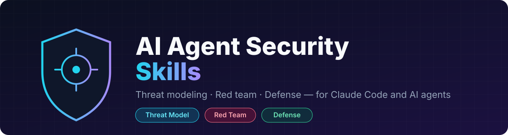
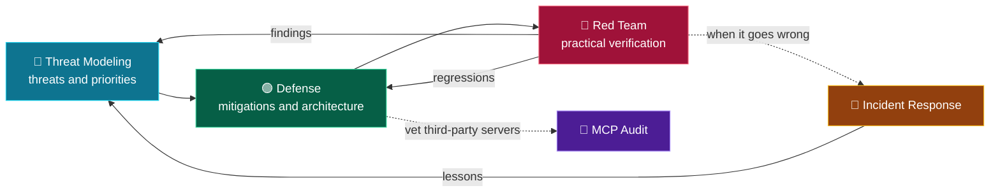
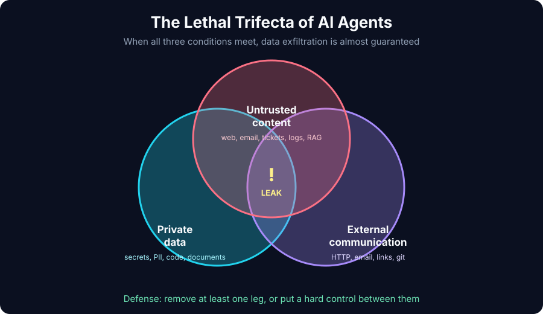
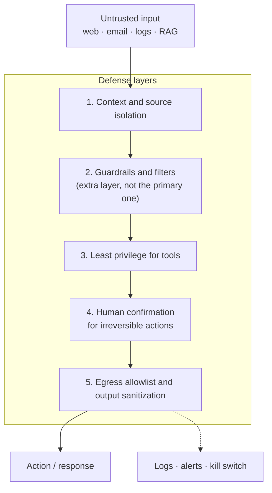
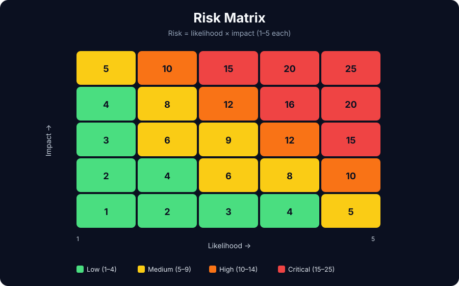

<p align="center">
  
</p>

<p align="center">
  <a href="LICENSE"></a>
  
  
  
  
  
</p>

<p align="center">
  <b>Skills for Claude Code and other agents: threat modeling, red teaming, and defense for AI agents.</b><br>
  Methodologies, checklists, and report templates grounded in OWASP and MITRE ATLAS.
</p>

---

## Why this exists

An AI agent is an LLM with **tools, memory, and access to external data**. Any untrusted text in its context works like code that an attacker can run with the agent's privileges. Prompt injection is still unsolved at the model level, so defense is built **around** the model: permissions, isolation, channel control, and human confirmation.

These skills turn that approach into a repeatable workflow.

## Five skills

| Skill | Role | What it does |
|---|---|---|
| [`ai-agent-threat-modeling`](skills/ai-agent-threat-modeling/SKILL.md) | 🧭 Architect | System description, data flows, trust boundaries, STRIDE + OWASP LLM, risk register |
| [`ai-agent-redteam`](skills/ai-agent-redteam/SKILL.md) | 🔴 Red team | Authorized testing: prompt injection, MCP/tool poisoning, exfiltration, reporting |
| [`ai-agent-defense`](skills/ai-agent-defense/SKILL.md) | 🟢 Blue team | Least privilege, isolation, human-in-the-loop, egress control, MCP security, checklist |
| [`mcp-server-audit`](skills/mcp-server-audit/SKILL.md) | 🔎 Reviewer | Vet an MCP server before connecting it: tool poisoning, rug pull, permissions, verdict |
| [`ai-agent-incident-response`](skills/ai-agent-incident-response/SKILL.md) | 🚨 Responder | Contain, preserve evidence, investigate and recover from an agent compromise |

## How they work together



Repeat the loop after every change: a new tool, a new data source, a model swap.

## The key idea: the lethal trifecta

<p align="center">
  
</p>

If an agent has **private data**, **untrusted content**, and **external communication** at the same time, exfiltration is almost guaranteed. The first check in any audit: are all three present? The best defense is to remove at least one leg.

## Defense in depth



## Risk rating

<p align="center">
  
</p>

Impact is determined by **tool permissions**, not by how "smart" the model is. Rate irreversible actions higher.

## What the red team skill covers

| Category | Examples |
|---|---|
| Direct prompt injection | Instruction override, system prompt extraction, multi-turn escalation |
| Indirect prompt injection | Web, email, tickets, **logs**, RAG, file metadata |
| Tool / MCP | Tool poisoning, rug pull, tool shadowing, path traversal, SSRF |
| Excessive agency | Irreversible actions without confirmation, dangerous action chains |
| Exfiltration | Markdown images and links, HTTP, email, public channels |
| Memory | Persistent injection, cross-user contamination |
| Multi-agent | Confused deputy, privilege inheritance |
| Infrastructure | Supply chain, DoS (unbounded consumption) |

All proof of impact relies on safe **canary values**, never on real damage.

## Articles

Long-form write-ups that explain the ideas behind the skills.

| Article | What it covers |
|---|---|
| [The Lethal Trifecta: Why AI Agents Leak Data, and the Cheapest Way to Stop It](articles/01-lethal-trifecta.md) | Private data, untrusted content and external communication, and how to break the triangle |
| [Your Logs Can Talk: Prompt Injection in an LLM-Assisted SOC](articles/02-your-logs-can-talk.md) | Keeping an LLM advisory in incident triage: sanitizing, output policy, fail-closed design, and a test that was too weak |
| [How to Audit an MCP Server Before You Connect It](articles/03-audit-an-mcp-server.md) | Tool poisoning, rug pulls, tool shadowing, a six-step review, and a script that pins tool definitions |
| [When Your Agent Gets Hijacked: An Incident Response Playbook](articles/04-agent-incident-response.md) | Containment order, evidence to preserve, transcript triage with a scanner script, recovery, and a postmortem |
| [Guardrails Are a Layer, Not a Wall: How to Measure Them Honestly](articles/05-measuring-guardrails.md) | Miss rate vs false block rate, sample size and confidence intervals, why retries compound, and a reporting script |

## Installation

```bash
git clone https://github.com/WaiperOK/ai-agent-security-skills.git
cd ai-agent-security-skills

# user level
mkdir -p ~/.claude/skills && cp -r skills/* ~/.claude/skills/

# or project level
mkdir -p <project>/.claude/skills && cp -r skills/* <project>/.claude/skills/
```

## Usage

Skills are picked up by their description or invoked explicitly:

```text
Build a threat model for my MCP agent
Run a red team review of this agent using the ai-agent-redteam methodology
Check this agent's architecture against the ai-agent-defense checklist
Audit this MCP server before I connect it to my agent
We think our agent leaked data through a poisoned ticket. Walk me through incident response
```

## Repository layout

```text
ai-agent-security-skills/
├── articles/                    # long-form write-ups
├── assets/                      # documentation graphics
├── skills/
│   ├── ai-agent-threat-modeling/SKILL.md
│   ├── ai-agent-redteam/SKILL.md
│   ├── ai-agent-defense/SKILL.md
│   ├── mcp-server-audit/SKILL.md
│   └── ai-agent-incident-response/SKILL.md
├── LICENSE
└── README.md
```

## Ethics and boundaries

These materials are for defense and **authorized** testing only: your own systems, labs, CTFs, and bug bounty programs within scope. Do not test systems you do not have permission to test. Disclose findings responsibly (coordinated disclosure).

## Foundations

- [OWASP Top 10 for LLM Applications (2025)](https://genai.owasp.org/llm-top-10/)
- OWASP Agentic AI - Threats and Mitigations
- [MITRE ATLAS](https://atlas.mitre.org/)

## License

[MIT](LICENSE)
