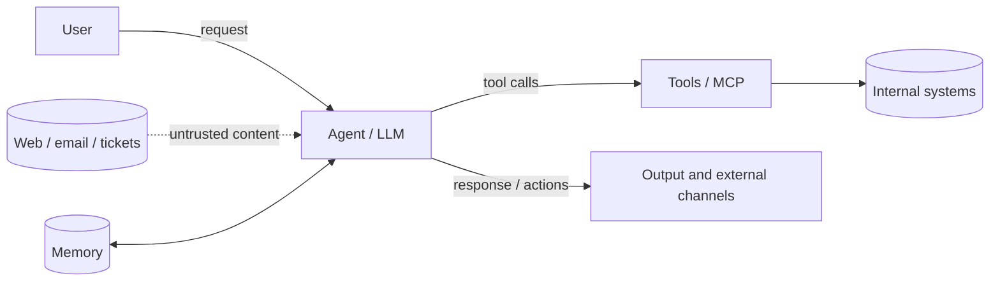

# AI Agent Threat Modeling

A structured process: understand the system, find threats, prioritize, assign mitigations.
The result is a document you can keep in the repository (`docs/THREAT_MODEL.md`) and update.

## Step 1. Describe the system

Gather facts (ask the user or read code and configs):

- **Purpose**: what the agent does, for whom, and the business impact of a mistake.
- **Components**: model (local or hosted), orchestrator, tools and MCP servers, RAG and data stores, memory, UI/API.
- **Data**: which data classes flow through (public, internal, PII, secrets) and where they are stored.
- **Actors**: owner, regular user, external content author, operator, attacker.
- **Permissions**: what the agent can read, change, and send.

## Step 2. Draw data flows and trust boundaries

Produce a data flow diagram (DFD), for example in Mermaid:



Mark the **trust boundaries**:
- between the user and the agent;
- between external content and the model context (the main boundary for injections);
- between the agent and tools / internal systems;
- between the agent and output channels (network, email, publishing);
- between agents in multi-agent systems.

Every boundary crossing is a place where threats appear.

## Step 3. Find threats

For each flow and boundary, walk through both lists.

### 3.1 STRIDE adapted for agents

| Category | AI agent example |
|---|---|
| **S**poofing | Forged content source, impersonating a trusted user or agent, fake MCP server |
| **T**ampering | RAG and memory poisoning, changed tool descriptions (rug pull), dependency substitution |
| **R**epudiation | No audit trail of who triggered an agent action and why, incomplete tool-call logs |
| **I**nformation disclosure | Exfiltration via links or requests, system prompt and secret leakage, cross-user leakage |
| **D**enial of service | Infinite agent loops, context flooding, token budget exhaustion |
| **E**levation of privilege | Confused deputy, abuse of over-privileged tools, sandbox escape |

### 3.2 LLM-specific (OWASP Top 10 for LLM Applications 2025)
Go through each item: LLM01 Prompt Injection, LLM02 Sensitive Information Disclosure, LLM03 Supply Chain, LLM04 Data and Model Poisoning, LLM05 Improper Output Handling, LLM06 Excessive Agency, LLM07 System Prompt Leakage, LLM08 Vector and Embedding Weaknesses, LLM09 Misinformation, LLM10 Unbounded Consumption.
For agents, also use OWASP Agentic AI - Threats and Mitigations and map techniques with MITRE ATLAS.

### 3.3 Mandatory check: the lethal trifecta
Does the system combine private data, untrusted content, and external communication? If so, treat it as a high-priority threat by default.

## Step 4. Rate the risk

For each threat:

- **Likelihood** (1-5): how easily an attacker can influence the input, how many conditions are needed.
- **Impact** (1-5): damage on success (data, money, human safety, reputation).
- **Risk** = likelihood x impact.

AI-specific considerations:
- Likelihood of injection through untrusted content is high if the agent reads external data without isolation.
- Impact is determined by **tool permissions**, not by how "smart" the model is.
- Rate irreversible actions higher.

## Step 5. Assign mitigations

For each significant threat, a concrete mitigation and an owner:

- Prefer **architectural** mitigations (permission reduction, isolation, egress control, human confirmation).
- Prompt-level measures and filters are an additional layer.
- The detailed mitigation catalog is in the `ai-agent-defense` skill.
- To verify the result, assign a test from the `ai-agent-redteam` skill.

Statuses: `mitigated` / `accepted` (with rationale and owner) / `open`.

## Step 6. Write the document

Template:

```markdown
# Threat Model: <system>
Version: X | Date: YYYY-MM-DD | Owner: ...

## 1. Description and security goals
## 2. Architecture and DFD (diagram)
## 3. Assets and data classes
## 4. Trust boundaries
## 5. Threat register
| ID | Threat | Category (STRIDE/OWASP) | Likelihood | Impact | Risk | Mitigation | Status | Test |
|----|--------|-------------------------|------------|--------|------|------------|--------|------|
## 6. Assumptions and accepted risks
## 7. Prioritized work plan
## 8. Change history
```

## When to revisit

- a new tool, MCP server, or data source is added;
- the agent's permissions are expanded or external channels are added;
- the model or provider changes;
- new attack techniques appear, or after an incident.

## Principles

- Start with **assets and consequences**, not with a list of vulnerabilities.
- A short, current model beats a perfect, forgotten one.
- Every threat must end in a verifiable mitigation or a conscious risk acceptance.
- If information is missing, write the assumption down explicitly and flag it for verification.
